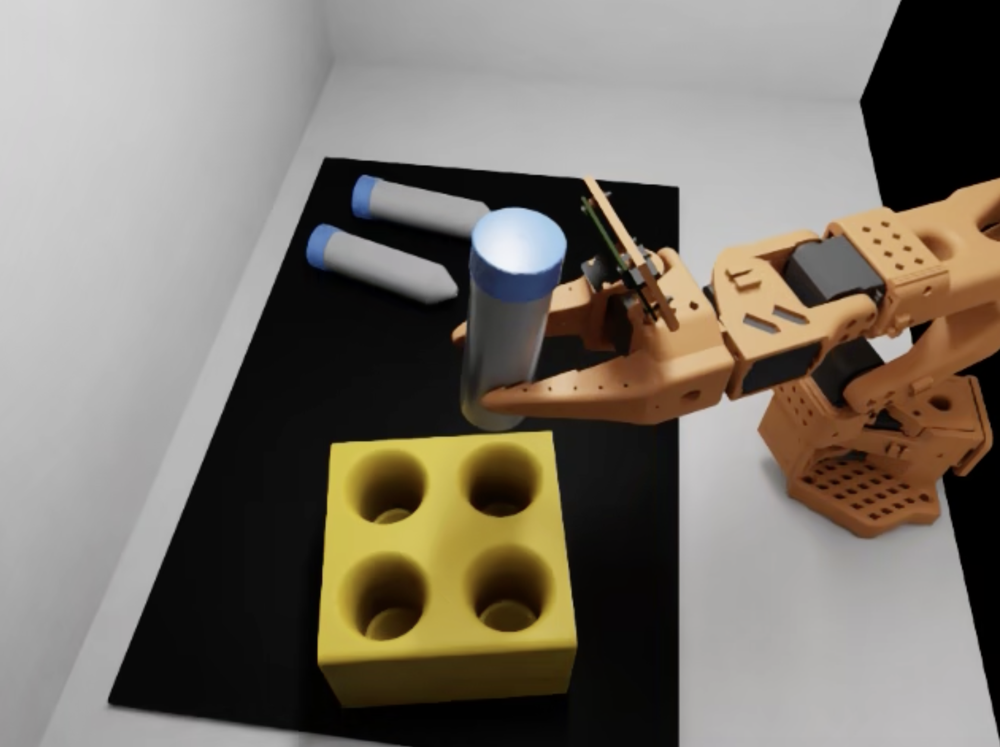

# Simulation Robot Teleoperation Platform

Generate robot manipulation training data entirely in simulation — no hardware, no human
teleoperators. Deploy one GPU instance with a single `cdk deploy`, and an AI agent running on Amazon
Bedrock takes the operator's seat: it looks at the scene, calls verified manipulation primitives to
complete the task, and records every episode as a standard **LeRobot** dataset that drops straight
into existing training pipelines. Each episode's success is judged from simulator ground truth, not
from the agent's own report, so the data you collect is labelled by measurement.



> **Running this costs money.** The stack creates a GPU EC2 instance that is billed every hour it is
> running (about US$3–8 per hour depending on the instance type) and the agent calls Amazon Bedrock
> (about US$0.05–0.30 per episode). Read [Costs](#costs) before deploying and stop the instance when you
> are not using it: `scripts/remote --stop`.

## Why this platform

- **Data without a lab.** A GPU instance replaces the robot, the cameras and the person at the
  leader arm. A 100-episode dataset takes an afternoon and costs tens of dollars.
- **An operator that handles the unexpected.** The agent decides which object to pick, which slot to
  use, when to look again and when to retry — a declined grasp, an occupied slot or a rolled vial is
  handled, not a failed run. Every decision is logged next to the data.
- **Labels you can trust.** Primitives return verdicts measured from the simulator (contact force,
  lift height, tilt, seating depth), and the episode runner re-judges every episode from ground truth.
  The model cannot loosen a criterion; it can only choose what to try next.
- **Standard output.** The upstream scene's own LeRobot recorder writes the dataset, so the format,
  units and camera names are exactly what a human-teleoperated session would produce. Train and
  evaluate with the upstream scripts unchanged.
- **Reproducible and self-contained.** The scene comes from NVIDIA's
  [Sim-to-Real SO-101 Workshop](https://github.com/isaac-sim/Sim-to-Real-SO-101-Workshop) at a pinned
  commit; the simulator image is built on the instance from the workshop's Dockerfile. Nothing from
  it is copied into this repository.
- **Built to be extended.** Robot-specific code is confined to three files; coding-agent
  [skills](./skills/README.md) walk through adding a primitive, debugging a grasp and porting the
  platform to another robot or scene.

| | |
|---|---|
| Robot | SO-101 arm, 5 joints + gripper (6-dim state and action) |
| Simulator | Isaac Lab 2.3.2 (Isaac Sim 5.x), headless or on a NICE DCV desktop |
| Task | three vials on a mat, a four-slot rack: pick a vial, stand it in a free slot (with a domain-randomised variant) |
| Operator | Strands agent on Amazon Bedrock — GPT-6 Astra by default, any Bedrock model via `--model` |
| Output | LeRobot v3 dataset: state and action (6), two camera streams (gripper and overview), 30 fps, plus a per-episode manifest with the measured verdict |
| Infrastructure | Python CDK: VPC, one GPU EC2 instance (`g7e.4xlarge` default, `g6e.4xlarge` supported), S3 bucket, IAM roles, SSM access, DCV |

## How it works

```
   GPU instance (host)                          simulator container (Isaac Lab Python)
 ┌──────────────────────────┐   JSON lines     ┌─────────────────────────────────────────┐
 │ simteleop-agent          │  TCP :7010       │ simteleop_sim.env_server                │
 │  Strands agent (Bedrock) ├─────────────────►│  gym.make(<workshop task>)              │
 │  tools: describe_scene,  │◄─────────────────┤  steps the physics at 60 Hz             │
 │   look, pick_vial,       │  verdicts,       │  ground truth: vials, rack, contact     │
 │   place_in_rack, move_*, │  camera JPEGs,   │  motions: joint interp, diff-IK, jaw    │
 │   recording              │  scene state     │  primitives with measured verdicts      │
 └──────────────────────────┘                  │  workshop LeRobotRecorder (30 fps)      │
                                               └─────────────────────────────────────────┘
```

The **environment server** runs inside the simulator container. It loads the workshop task, steps the
physics, reads ground truth (object poses, contact forces, joint states) and exposes two kinds of
tools over a small JSON protocol: **verified primitives** (`pick_vial`, `place_in_rack`, `home`) that
return a measured verdict, and **low-level moves** (`move_gripper_to`, `jog_joints`, `gripper`) for
genuine teleoperation when a primitive cannot serve. A placement counts only if the vial stands within
15° of vertical and is seated in the slot.

The **agent** runs on the host with the instance role's Bedrock access. It sees the scene through
ground truth and two cameras, calls the tools, and controls the recorder. `place_in_rack` hands back an
overview camera frame with its numbers so the model looks at the result it is told about. At the end of
each episode the **runner** judges success again from ground truth, independent of what the agent
claimed, and writes the verdict into the episode's manifest.

You can also drive the environment server from a script with no model in the loop — the same
primitives, deterministic given the seed — to measure the primitives or collect data when the layout
is known. See [Agent or script?](./docs/operating.md#agent-or-script).

## Quick start

Prerequisites: an AWS account with [Bedrock model access](https://docs.aws.amazon.com/bedrock/latest/userguide/model-access.html)
enabled for the model you will use, the AWS CLI and CDK CLI, Python 3.9+, and a workstation with
credentials for the account. Nothing else is installed locally; everything runs on the instance.

**1. Deploy** (about an hour to a ready platform, most of it the simulator image build on first boot):

```bash
git clone <this repository> && cd sim-teleop-platform
cd infrastructure
python3 -m venv .venv && . .venv/bin/activate && pip install -r requirements.txt
cdk bootstrap                                                      # once per account and region
cdk deploy -c dcvAllowedCidr=$(curl -s https://checkip.amazonaws.com)/32 \
           -c operatorPrincipalArns=$(aws sts get-caller-identity --query Arn --output text | sed -E 's#:sts:#:iam:#; s#assumed-role/([^/]+)/.*#role/\1#')
cd ..
scripts/remote --outputs                                           # instance id, bucket, DCV URL
scripts/remote grep -c "the platform is ready" /var/log/simteleop-bootstrap.log   # prints 1 when the first boot is done
```

`operatorPrincipalArns` names who may operate the instance (the IAM role or user you run the scripts
as). Other context keys — instance type, availability zone, volume size, workshop commit, model id —
are listed in [`infrastructure/README.md`](./infrastructure/README.md).

**2. Collect** (from the same workstation; the scripts talk to the instance over SSM, no SSH):

```bash
scripts/remote simteleop-up                 # simulator container + environment server, headless
scripts/remote simteleop-status             # environment server answering, 3 vials, 4 free slots
scripts/remote simteleop-agent --check      # dependencies, environment server, one Bedrock call
scripts/remote --detach ep1 simteleop-agent --episodes 5 --out /home/ubuntu/simteleop/runs/ep1
scripts/remote --wait ep1                   # about 3 min per episode; ends with RESULT: n/5 episodes succeeded by ground truth
```

**3. Get the data, stop paying:**

```bash
scripts/remote simteleop-publish agent_vials_to_rack /home/ubuntu/simteleop/runs/ep1   # dataset + run logs to S3
scripts/pull-results agent_vials_to_rack ep1                                             # ... and to ./outputs/
scripts/remote --stop                                                                    # the GPU instance is billed while running
```

```python
from lerobot.datasets.lerobot_dataset import LeRobotDataset
ds = LeRobotDataset("local/agent_vials_to_rack", root="outputs/datasets/agent_vials_to_rack")
```

Every command, option and output file is described in [Operating the platform](./docs/operating.md).

## What to expect

Measured on an unattended 100-episode run with the default model on a `g6e.4xlarge`:

| | |
|---|---|
| Episodes succeeded by ground truth | **98 of 100** |
| Wall time per episode | about 3 minutes on average (2–9 min), most of it model latency |
| Tool calls per episode | about 12 (9–28) |
| Dataset | 100 episodes, 185,000 frames, 2.1 GB; the two failures are recorded and labelled `success: false` |
| Cost | about US$19 of instance time and US$5–31 of Bedrock for the whole run |

The two failures were a grasp that slipped and a placement the primitive refused to release because
the vial was tilted; the agent retried, then stopped the recording as unsuccessful, and the runner
agreed. Scripted pick-and-place, with no model, takes about 75 s per episode.

## Costs

| Item | Approximate cost |
|---|---|
| GPU instance, `g6e.4xlarge` / `g7e.4xlarge` | US$3–4 / US$5–8 per hour **while running, idle or not** |
| Root volume (400 GB) | about US$30 per month while the instance exists |
| Bedrock, GPT-6 Astra | US$0.05–0.30 per agent episode |
| An agent episode, all in | about US$0.25–0.50; a scripted episode about US$0.07 |
| A 100-episode dataset | about US$30–55 if the instance is stopped afterwards |

The instance is the cost that gets away: a day of idle time is US$70–100, more than a hundred
episodes. Details, the measurements behind these numbers and a worked example are in
[`docs/costs.md`](./docs/costs.md).

## Extending the platform

- **Another task or robot.** Robot-specific code is confined to `sim/simteleop_sim/scene_state.py`
  (ground truth), `sim/simteleop_sim/primitives.py` (motions and verdicts) and the joint tables in
  `common/simteleop_common/protocol.py`. The [new-embodiment skill](./skills/simteleop-new-embodiment/SKILL.md)
  walks through the port.
- **A new primitive.** Derive the motion from the object's geometry, verify by measurement, decline
  layouts it cannot serve, and expose it as a tool: [add-primitive skill](./skills/simteleop-add-primitive/SKILL.md).
- **A grasp that fails.** The [debug skill](./skills/simteleop-debug-manipulation/SKILL.md) and its
  `probe.py` measure a primitive over seeds and show what the simulator saw.
- **Another model.** Any Bedrock model id via `--model` or the `agentModelId` context key.
- **Working with a coding agent?** [`AGENTS.md`](./AGENTS.md) is the operating contract: conventions,
  invariants and how to verify a change.

## Documentation

| Page | Content |
|---|---|
| [`docs/operating.md`](./docs/operating.md) | workstation scripts, instance commands, running the agent, knobs, scripted control, outputs, verifying a deployment |
| [`docs/agent_teleoperation.md`](./docs/agent_teleoperation.md) | the agent's tools, verdict criteria, how the primitives move |
| [`docs/protocol.md`](./docs/protocol.md) | the environment server's JSON protocol |
| [`docs/costs.md`](./docs/costs.md) | prices, measured usage, a 100-episode worked example |
| [`docs/security.md`](./docs/security.md) | what is protected, known trade-offs, what to change before sharing |
| [`docs/troubleshooting.md`](./docs/troubleshooting.md) | symptoms and fixes |
| [`infrastructure/README.md`](./infrastructure/README.md) | the CDK stack, context keys, first boot, updating a running instance |
| [`skills/`](./skills/README.md) | step-by-step skills for coding agents: operate, add a primitive, debug, new embodiment |
| [`VERSIONS.md`](./VERSIONS.md) | pinned versions and why |

## Security

No inbound rule — shell access over SSM, the desktop only from the CIDR you pass; least-privilege
roles for the instance and the operator; an encrypted, versioned bucket; no long-lived credentials
anywhere; and an agent that cannot change what counts as success or reach a shell. It is designed as a
single-user research instance: the environment server is unauthenticated on localhost, egress is open,
and there are no alarms. What to change before sharing the instance or the account is in
[`docs/security.md`](./docs/security.md). To report a vulnerability, see
[CONTRIBUTING.md](./CONTRIBUTING.md#security-issue-notifications).

## Usage reporting

This repository is published as an AWS Solution and carries the solution's identity in two places so
that deployments and API usage can be counted: the CloudFormation stack's `Description`
(`(<id>) - <solution name>. Version <version>`), and an `AWSSOLUTION/<id>/<version>` token on the
`User-Agent` header of the AWS SDK calls the agent makes. Both read `common/simteleop_common/solution.json`,
the only place these values are written. The id and version are the same constants for every user;
nothing about you, your account, your instance or your data is included, and no resource tags are
involved. To opt out, delete the `solution` block from that file: SDK calls then go out without the
token, and `cdk synth` asks you to pass your own `description=` in `infrastructure/app.py` rather than
deploying an uncounted stack. The AWS CLI calls made by the workstation scripts, the first-boot
bootstrap and `simteleop-publish` are not attributed; the CLI has no hook for it.

## Repository layout

```
infrastructure/              CDK app; assets/bootstrap (first boot); assets/bin (simteleop-* commands)
scripts/                     remote (SSM runner), push-code, pull-results — operate the instance from a workstation
sim/simteleop_sim            environment server, scene ground truth, motions, primitives, recorder wrapper
agent/simteleop_agent        Strands agent, tools, prompt, Bedrock image hoisting, preflight, episode runner
common/simteleop_common      protocol (JSON lines), geometry and LeRobot unit mapping, solution identity   [tested]
tests/                       unit tests; `python -m pytest -q` from the root, no simulator needed
docs/                        operating guide, agent and protocol references, costs, security, troubleshooting
skills/                      step-by-step skills for coding agents
AGENTS.md                    how a coding agent should work in this repository
VERSIONS.md                  pinned versions
```

## License

This project is licensed under the MIT-0 License. See [LICENSE](./LICENSE). Contributions are
welcome; see [CONTRIBUTING.md](./CONTRIBUTING.md) and the [Code of Conduct](./CODE_OF_CONDUCT.md).
